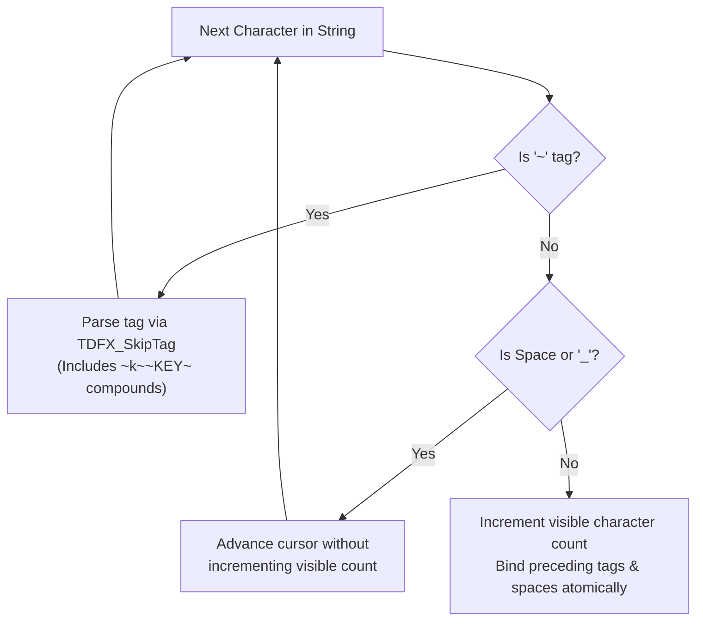

# TextDrawFX

[](https://github.com/Walter-Correa/TextDrawFX/releases)
[](https://opensource.org/licenses/MPL-2.0)
[](https://open.mp)

**TextDrawFX** is a high-performance, lightweight, zero-dependency visual effects, animation, and textdraw blinking library engineered specifically for **San Andreas Multiplayer (SA-MP)** and **Open.MP**. It enables Pawn scripts to render rich visual UI animations—including classical visibility flashing, synchronized dual-color alert shifts, and cinematic character-by-character typewriter animations with intelligent GTA:SA formatting tag parsing.

> [!NOTE]
> **TextDrawFX** is an original, fully authorial library designed from the ground up for maximum runtime efficiency, zero-allocation stability, and modular extensibility. It operates with 100% cross-compatibility between legacy SA-MP and modern open.mp servers without requiring `#define SAMP_COMPAT`.

---

## Highlights & Key Features

* **Three Distinct Visual Animation Modes:**
  * **`Mode 1: Visibility Blink` (`colour = 0`):**
    Classical periodic toggle between visible (`PlayerTextDrawShow`) and hidden (`PlayerTextDrawHide`) states at user-configured millisecond intervals. Operates seamlessly on all TextDraw styles: plain text, GTA sprite textures (Font 4), 3D preview models (Font 5), and framed boxes.
  * **`Mode 2: Chromatic Alert Flash` (`colour != 0`):**
    The textdraw never disappears from the screen, preventing awkward visual UI layout shifting. Instead, it dynamically alternates between an accent/alert flash color (`0xRRGGBBAA`) and its original base color.
    * **Text & Sprites:** Flashes the foreground text tint or sprite texture color.
    * **Box Elements:** Simultaneously updates both text and box framing colors in lockstep.
    * **3D Preview Models (Font 5):** The GTA:SA engine cannot tint 3D models directly; therefore, the library flashes the background canvas box while keeping the 3D preview model pristine.
  * **`Mode 3: Cinematic Typewriter Animation` (`perChar = true`):**
    Progressively reveals text strings character by character at each interval tick. Once fully typed, it pauses for one interval before looping or concluding. Can be combined with an accent color to highlight the text while typing.

* **Smart GTA:SA Tag & Whitespace Parser (`TDFX_SkipTag` & `TDFX_Cut`):**
  * The GTA:SA client engine fails to render strings that end in whitespace and produces blank, empty frames when isolated color codes (`~r~`, `~y~`, `~g~`, etc.) or control codes appear at the end of a string slice.
  * **TextDrawFX** features an atomic tag-skipping parser that groups color tags, keybind tokens (`~k~~KEY_NAME~`), newline delimiters (`~n~`), space characters, and underscores (`_`) with the next printable glyph, ensuring flicker-free typewriter output.

* **Dynamic Auto-Pacing Duration Compensation:**
  * When a target `duration` is set for a typewriter animation, the engine calculates whether $\text{characters} \times \text{interval} > \text{duration}$.
  * If the string length exceeds the allotted timeframe, the interval is dynamically compressed to $\text{duration} / \text{characters}$ (clamped to `TDFX_MIN_INTERVAL = 50ms`), guaranteeing that the complete message renders within the requested duration.

* **100% Cross-Compatible Without `#define SAMP_COMPAT`:**
  * **Zero Deprecation Warnings:** On open.mp, American-spelled functions (`PlayerTextDrawColor`, `PlayerTextDrawBoxColor`, etc.) emit `#pragma deprecated` warning 234. **TextDrawFX** routes internal calls through non-deprecated British canonical names (`Colour`, `BoxColour`, `BackgroundColour`) while maintaining 100% compatibility on SA-MP 0.3.7.
  * **Native Getters with Memory Cache Fallback:** Automatically queries open.mp native getters (`PlayerTextDrawGetFont`, `PlayerTextDrawIsBox`, `PlayerTextDrawGetString`, `PlayerTextDrawGetColour`, etc.) when running on open.mp. On legacy SA-MP servers where getters do not exist, it falls back to an internal ALS-hooked memory state cache.
  * **Tag-Safe Multi-Tag Hooks:** Utilizes multi-tag parameters (`{TEXT_DRAW_FONT, _}:font` and `{bool, _}:use`) so both strong enums and integer literals compile with zero tag mismatch warnings (`warning 213`).
  * **Self-Contained Header:** Automatically detects `<open.mp>` and `<a_samp>` headers and includes safety guards against double inclusion.

* **Transparent State Interception & Lifecycle Safety:**
  * Hooks into `PlayerTextDrawColor`/`Colour`, `PlayerTextDrawBoxColor`/`BoxColour`, and `PlayerTextDrawBackgroundColor`/`BackgroundColour` to intercept live color alterations without breaking active flash cycles.
  * Modifying strings via `PlayerTextDrawSetString` during a typewriter animation updates the typing buffer live without restarting.
  * Calling `PlayerTextDrawHide` or `PlayerTextDrawDestroy` terminates active timers and frees memory slots immediately.
  * Full `OnPlayerDisconnect` ALS hook guarantees zero dangling timers or memory leaks when players disconnect.

---

## Installation

### 1. File Placement

Copy `TextDrawFX.inc` into your server's include directory:
* **SA-MP / Pawno:** `pawno/include/TextDrawFX.inc`
* **open.mp / Qawno:** `qawno/include/TextDrawFX.inc`

### 2. Script Inclusion

Add the include near the top of your gamemode or filterscript, after `<a_samp>` or `<open.mp>`:

```pawn
#include <open.mp> // or <a_samp>
#include <TextDrawFX>
```

> [!TIP]
> If `<open.mp>` or `<a_samp>` has not yet been included when `<TextDrawFX>` is parsed, the include will automatically detect and include the correct header for you.

---

## Configuration & Compile-Time Defines

You can customize the following configuration constants before including `<TextDrawFX>` to tailor memory usage and performance:

| Constant | Default Value | Unit / Constraints | Description |
| :--- | :---: | :---: | :--- |
| `TDFX_MAX_BLINKS` | `32` | Slots ($1$ - $512$) | Maximum concurrent textdraw animations active simultaneously across the server. |
| `TDFX_MAX_TEXT` | `256` | Cells (Characters) | Maximum string buffer size allocated for typewriter text handling. |
| `TDFX_MAX_TD` | `MAX_PLAYER_TEXT_DRAWS` (`256`) | Range ($1$ - $256$) | Maximum PlayerTextDraw IDs cached per player for SA-MP color fallback. Lowering this reduces RAM footprint. |
| `TDFX_MIN_INTERVAL` | `50` | Milliseconds | Hard lower limit for animation timer intervals (prevents timer spam). |

```pawn
// Example: Optimizing memory footprint for lightweight servers
#define TDFX_MAX_BLINKS 16
#define TDFX_MAX_TD 64
#include <TextDrawFX>
```

---

## API Reference

### Functions

#### 1. Visual Animations & Blinking

```pawn
stock BlinkPlayerTextDraw(playerid, PlayerText:textid, interval = 500, duration = 0, bool:perChar = false, colour = 0, const text[] = "", baseColour = 0);
```
Activates a visual blinking or typewriter animation on a player textdraw. Calling this function on a textdraw that is already animating safely replaces the previous animation.
* **`playerid`:** The ID of the player who owns the PlayerTextDraw.
* **`textid`:** The PlayerTextDraw handle to animate.
* **`interval`:** Time in milliseconds between each animation toggle or character typing step (minimum `50ms`, defaults to `500ms`).
* **`duration`:** Total duration in milliseconds for the animation. Passing `0` keeps the effect running indefinitely until stopped manually.
* **`perChar`:**
  * `false` *(default)*: Blinks the entire textdraw on/off or shifts color.
  * `true`: Enables typewriter mode, revealing text character by character. (Disabled automatically for sprites and preview models).
* **`colour`:**
  * `0` *(default)*: Visibility blinking (textdraw toggles between shown and hidden).
  * `0xRRGGBBAA`: Color shift blinking (textdraw stays visible and alternates between this color and `baseColour`). In `perChar` mode, text is rendered in this color while typing.
* **`text[]`:** Explicit text string to use for `perChar` mode. If omitted or left empty (`""`), the include automatically retrieves the current text from open.mp's `PlayerTextDrawGetString`.
* **`baseColour`:** Original color to restore when unlit or when the effect ends. If omitted (`0`), the include retrieves the color via open.mp getters or its internal SA-MP memory cache.
* **Returns:** `1` on success, `0` if player is disconnected, textdraw handle is invalid, or the animation pool is full.

---

#### 2. Lifecycle & Query Control

```pawn
stock StopPlayerTextDrawBlink(playerid, PlayerText:textid);
```
Stops any active blinking or typewriter animation on the specified textdraw immediately. Kills the underlying timer, restores original colors, reveals the full text string, and ensures the textdraw is left visible on screen.
* **`playerid`:** The ID of the player.
* **`textid`:** The PlayerTextDraw handle.
* **Returns:** `1` on success, `0` if the textdraw was not blinking.

```pawn
stock bool:IsPlayerTextDrawBlinking(playerid, PlayerText:textid);
```
Checks whether a player textdraw is currently undergoing a blinking or typewriter animation.
* **`playerid`:** The ID of the player.
* **`textid`:** The PlayerTextDraw handle.
* **Returns:** `true` if active, `false` otherwise.

---

#### 3. Automatically Hooked Functions (ALS)

The include implements standard **Advanced Library System (ALS)** hooks to maintain absolute synchronization between the game server and animation states:

| Hooked Function | Behavior When Animating |
| :--- | :--- |
| `PlayerTextDrawHide` | Hiding an animated textdraw terminates the effect immediately and leaves the textdraw hidden. |
| `PlayerTextDrawDestroy` | Destroying a textdraw safely terminates its effect, stops timers, and clears cached state. |
| `PlayerTextDrawSetString` | Calling `SetString` on an active `perChar` textdraw dynamically updates the text being typed live. |
| `PlayerTextDrawColor` / `Colour` | Updating color while animating registers the new baseline color without breaking an active flash. |
| `PlayerTextDrawBoxColor` / `BoxColour` | Updates the baseline box color; maintains synchronized dual-color box flashing. |
| `PlayerTextDrawBackgroundColor` / `BackgroundColour` | Updates the baseline background color (used for preview models). |
| `PlayerTextDrawFont` | Tracks font changes (`0` - `5`) to automatically identify sprites and preview models. |
| `PlayerTextDrawUseBox` | Tracks box state to enable simultaneous text and box flashing. |
| `OnPlayerDisconnect` | Cleans up all active animations, frees memory, and clears state arrays when a player disconnects. |

---

## Animation Modes Detailed

### Mode 1: Classical Visibility Blink (`colour = 0`)
The textdraw flashes between visible and invisible at the specified interval:

```pawn
// Flash a warning textdraw on and off every 400ms for 5 seconds
BlinkPlayerTextDraw(playerid, gWarningTD[playerid], 400, 5000);
```

```text
[Interval 0ms] Shown  -->  [Interval 400ms] Hidden  -->  [Interval 800ms] Shown ...
```

---

### Mode 2: Chromatic Alert Flash (`colour != 0`)
The textdraw never disappears, avoiding UI layout jumping. Instead, it alternates between an alert color and its normal color:

```pawn
// Alternate between Bright Red (0xFF0000FF) and normal color every 250ms indefinitely
BlinkPlayerTextDraw(playerid, gHealthTD[playerid], 250, 0, false, 0xFF0000FF);
```

```text
[Interval 0ms] Red (0xFF0000FF)  -->  [Interval 250ms] Base Color  -->  [Interval 500ms] Red ...
```

---

### Mode 3: Typewriter Animation (`perChar = true`)
Reveals the message one character at a time. Ideal for RPG dialogues, cutscene subtitles, mission briefings, and terminal outputs:

```pawn
// Typewriter effect: 80ms per character, in yellow text, running for 6 seconds
BlinkPlayerTextDraw(playerid, gSubtitleTD[playerid], 80, 6000, true, 0xFFFF00FF, "Mission: Infiltrate the military base.");
```

```text
[Step 1] "M"
[Step 2] "Mi"
[Step 3] "Mis"
...
[Step N] "Mission: Infiltrate the military base." (Pauses for 1 interval, then resets or finishes)
```

---

## Usage Examples

### 1. Critical Low-Health Alarm (Boxed HUD Alert)

A dynamic health warning that flashes bright red when health drops below 20%:

```pawn
#include <open.mp> // or <a_samp>
#include <TextDrawFX>

new PlayerText:gHealthHUD[MAX_PLAYERS] = {PlayerText:INVALID_TEXT_DRAW, ...};

public OnPlayerConnect(playerid)
{
    gHealthHUD[playerid] = CreatePlayerTextDraw(playerid, 550.0, 100.0, "HP: 100");
    PlayerTextDrawFont(playerid, gHealthHUD[playerid], TEXT_DRAW_FONT_2);
    PlayerTextDrawLetterSize(playerid, gHealthHUD[playerid], 0.25, 1.2);
    PlayerTextDrawColor(playerid, gHealthHUD[playerid], 0xFFFFFFFF);
    PlayerTextDrawUseBox(playerid, gHealthHUD[playerid], true);
    PlayerTextDrawBoxColor(playerid, gHealthHUD[playerid], 0x000000AA);
    PlayerTextDrawShow(playerid, gHealthHUD[playerid]);
    return 1;
}

public OnPlayerUpdate(playerid)
{
    if (gHealthHUD[playerid] != PlayerText:INVALID_TEXT_DRAW)
    {
        new Float:hp;
        GetPlayerHealth(playerid, hp);

        if (hp <= 20.0 && !IsPlayerTextDrawBlinking(playerid, gHealthHUD[playerid]))
        {
            // Flash both text and box in bright red every 200ms
            BlinkPlayerTextDraw(playerid, gHealthHUD[playerid], 200, 0, false, 0xFF0000FF);
        }
        else if (hp > 20.0 && IsPlayerTextDrawBlinking(playerid, gHealthHUD[playerid]))
        {
            // Restore normal white text and dark box
            StopPlayerTextDrawBlink(playerid, gHealthHUD[playerid]);
        }
    }
    return 1;
}
```

---

### 2. Mission Briefing Subtitle with GTA:SA Color Codes

Demonstrates typewriter mode handling GTA inline color codes (`~y~`, `~w~`) and spaces smoothly without visual hiccups:

```pawn
stock ShowMissionBriefing(playerid, const briefing[])
{
    new PlayerText:td = gMissionSubtitleTD[playerid];
    
    // Type out the briefing over 5 seconds (5000ms) with duration auto-pacing
    BlinkPlayerTextDraw(
        playerid, 
        td, 
        .interval = 75, 
        .duration = 5000, 
        .perChar = true, 
        .colour = 0, 
        .text = briefing
    );
}

// Example invocation:
ShowMissionBriefing(playerid, "~y~Officer Tenpenny:~w~ Pick up the package from the docks.");
```

---

### 3. "Press `~k~~PED_FIREWEAPON~` to Start" Interaction Prompt

A classic GTA prompt blinking visibility every 500 milliseconds:

```pawn
stock ShowInteractionPrompt(playerid)
{
    PlayerTextDrawSetString(playerid, gPromptTD[playerid], "Press ~k~~CONVERSATION_YES~ to talk");
    PlayerTextDrawShow(playerid, gPromptTD[playerid]);

    // Classical visibility blink: interval 500ms, continuous
    BlinkPlayerTextDraw(playerid, gPromptTD[playerid], 500);
}

stock HideInteractionPrompt(playerid)
{
    // Calling PlayerTextDrawHide automatically stops the blink!
    PlayerTextDrawHide(playerid, gPromptTD[playerid]);
}
```

---

### 4. 3D Vehicle Preview Canvas Alert

Flashing the background canvas of a 3D vehicle showroom preview model:

```pawn
stock AlertShowroomSelection(playerid, PlayerText:previewTD)
{
    // For Font 5 (preview models), the color shift automatically
    // flashes the background color (canvas) without touching the 3D model
    BlinkPlayerTextDraw(
        playerid, 
        previewTD, 
        .interval = 300, 
        .duration = 3000, 
        .colour = 0x3498DBAA // Translucent Electric Blue flash
    );
}
```

---

## Technical Specifications & Architecture

### Smart Tag & Token Skipping Algorithm

GTA:SA textdraw rendering has strict internal parsing rules. The engine evaluates text streams sequentially:
* Color tags format as `~c~` where `c` is a letter (`~r~`, `~g~`, `~b~`, `~w~`, `~y~`, `~p~`, `~l~`, `~s~`).
* Special symbols use `~n~` (newline), `~u~` (up arrow), `~d~` (down arrow), `<` (left arrow), and `>` (right arrow).
* Keybind tokens format as `~k~~ACTION_NAME~` (e.g. `~k~~PED_FIREWEAPON~`).
* Trailing spaces or lone control characters produce an empty string or invisible text.

**TextDrawFX** processes text using an atomic state parser:



This guarantees that every incremental frame in a typewriter animation displays valid, printable glyphs.

---

### open.mp vs. SA-MP Compatibility Matrix

| Aspect | Legacy SA-MP 0.3.7 | open.mp (`_INC_open_mp`) | How TextDrawFX Solves It |
| :--- | :--- | :--- | :--- |
| **Color API Spellings** | `PlayerTextDrawColor` only | `PlayerTextDrawColour` (preferred)<br>`PlayerTextDrawColor` (deprecated) | Hooks both spellings and redirects internal calls through `_TDFX_TDColour` to prevent `warning 234`. |
| **Getters (`Font`, `Box`, `Text`)** | None | `PlayerTextDrawGetFont`<br>`PlayerTextDrawIsBox`<br>`PlayerTextDrawGetString` | Detects native getters at compile time; falls back to internal memory cache on legacy SA-MP. |
| **Font Tagging** | Raw integer | `TEXT_DRAW_FONT:` strong enum | Multi-tag `{TEXT_DRAW_FONT, _}:font` hook accepts both raw integers and tagged enum constants cleanly. |
| **UseBox Tagging** | Raw integer | `bool:` boolean | Multi-tag `{bool, _}:use` hook accepts both `1`/`0` and `true`/`false` without tag mismatch warnings. |
| **`#define SAMP_COMPAT`** | Not applicable | Often required by unoptimized libraries | **Never required.** 100% warning-free out of the box. |

---

## Version History

<details>
<summary>Show the version history</summary>

### 1.0.0 - 01/11/2026
* Initial public release of **TextDrawFX**:
  * 100% original, authorial implementation.
  * Three distinct animation modes: Visibility Blink (`colour = 0`), Chromatic Color Flash (`colour != 0`), and Typewriter Animation (`perChar = true`).
  * Full support for text fonts (`0` - `3`), sprite textures (Font `4`), 3D preview models (Font `5`), and boxed textdraws.
  * Smart GTA formatting tag and whitespace tokenizer (`TDFX_SkipTag` & `TDFX_Cut`) supporting `~r~`, `~k~~KEY~`, `~n~`, spaces, and underscores.
  * Dynamic auto-pacing duration compensation for typewriter animations.
  * Universal cross-compatibility between SA-MP and open.mp without `#define SAMP_COMPAT` or `#define MIXED_SPELLINGS`.
  * Multi-tag hooks for `PlayerTextDrawFont` and `PlayerTextDrawUseBox` eliminating `warning 213`.
  * Complete ALS hook suite for `PlayerTextDrawColor`/`Colour`, `PlayerTextDrawBoxColor`/`BoxColour`, `PlayerTextDrawBackgroundColor`/`BackgroundColour`, `PlayerTextDrawFont`, `PlayerTextDrawUseBox`, `PlayerTextDrawHide`, `PlayerTextDrawDestroy`, `PlayerTextDrawSetString`, and `OnPlayerDisconnect`.
  * Clean, comment-free include file structure with modular function grouping.
  * Automatic header detection (`#tryinclude <open.mp>` / `#include <a_samp>`) and include guards.
  * Released under the **Mozilla Public License 2.0 (MPL-2.0)**.

</details>

---

## Author & Credits

* **Walter Corrêa** ([@Walter-Correa](https://github.com/Walter-Correa)) - Creator & Maintainer of **TextDrawFX**.

---

## License

This project is licensed under the **Mozilla Public License 2.0 (MPL-2.0)**. See the [LICENSE](LICENSE) file for complete legal terms.
